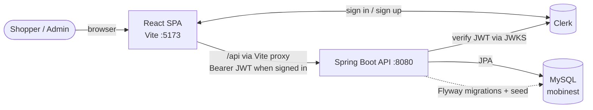

<div align="center">


# Namma Mobiles

**Every phone. Every brand. One destination.**

A full-stack e-commerce platform for India that sells **only mobile phones**: brand-new, certified refurbished, pre-owned and eco-recycled, plus matching accessories. Built with **React 19** on the front, **Spring Boot 4 + Java 21** on the back, **MySQL** for data and **Clerk** for sign-in.


**Live demo:** [namma-mobiles.vercel.app](https://namma-mobiles.vercel.app) · API on Railway ([Swagger](https://mobinest-api-production.up.railway.app/swagger-ui.html)) · [How it's deployed](mobinest-api/context/DEPLOYMENT.md)


</div>

---

## 📖 Table of contents
- [What it does](#-what-it-does)
- [Screenshots](#-screenshots)
- [Tech stack](#-tech-stack)
- [How it works](#-how-it-works)
- [Repository structure](#-repository-structure)
- [Getting started](#-getting-started)
- [Admin access](#-admin-access)
- [Testing](#-testing)
- [Documentation](#-documentation)
- [Roadmap](#-roadmap)
- [Notes for students](#-notes-for-students)
- [Legal & credits](#-legal--credits)

---

## ✨ What it does

| For shoppers | For admins |
|---|---|
| 🛍️ Browse the **latest iPhone, Galaxy and Pixel** phones by brand, price range and condition | 📊 **Dashboard**: revenue, orders by status, top sellers, low stock |
| ♻️ Buy each phone **New, Refurbished, Pre-owned or Recycled**, each with a warranty | 📦 **Orders**: search and filter, view details, move through Confirmed → Shipped → Delivered, or Cancel (restores stock) |
| 🔍 **Smart search** with live suggestions (Aceternity "vanish" input) | 💳 **Transactions**: every payment by method and status |
| ⚖️ **Compare** up to 4 phones side by side | 🏷️ **Catalogue**: switch brands on or off, edit SKU price and stock, accessories |
| ❤️ Wishlist, 🛒 cart with **coupons**, free delivery from ₹499 | 🎟️ **Coupons**: create, edit, deactivate |
| ✅ **Checkout** as guest or signed in (UPI / card / EMI / net banking / COD up to ₹50,000) | 👥 **Customers**: order history and spend, promote or demote admins |
| 📜 **My orders**, plus a **sell / recycle** instant trade-in quote | 🧾 **Audit log** of admin actions |
| 🌗 **Light / dark mode**, 🎬 official brand films, 📱 fully responsive | 🔐 Protected by **Clerk sign-in + ADMIN role** |

> **Payments:** online payments are currently **simulated** (marked paid instantly) and COD is real-world pending. Razorpay integration is planned; see [`PAYMENTS.md`](mobinest-api/context/PAYMENTS.md).

---

## 📸 Screenshots

| Light | Dark |
|---|---|
| **Live demo:** [namma-mobiles.vercel.app](https://namma-mobiles.vercel.app) · API on Railway ([Swagger](https://mobinest-api-production.up.railway.app/swagger-ui.html)) · [How it's deployed](mobinest-api/context/DEPLOYMENT.md)

 |  |
|  |  |

---

## 🧰 Tech stack

| Layer | Technologies |
|---|---|
| **Frontend** | React 19 · Vite 8 · React Router 7 · JavaScript (JSX) |
| **Styling & UI** | Hand-written CSS with design tokens · Tailwind CSS v4 (utilities, no preflight) · shadcn/ui · **Aceternity UI** (Spotlight, Vanish search, Card Hover Effect) · **Magic UI** (animated theme toggler) · `motion` · Plus Jakarta Sans |
| **Auth** | Clerk (`@clerk/react`, `@clerk/themes`): hosted sign-in; the API verifies Clerk JWTs |
| **Backend** | Spring Boot 4.1 · Java 21 · Spring Security 7 (OAuth2 Resource Server) · Spring Data JPA / Hibernate 7 · Bean Validation · springdoc-openapi (Swagger UI) |
| **Database** | MySQL 8 · Flyway migrations (V1–V7) |
| **Tooling** | Maven wrapper · npm · ESLint · JUnit 5 · Playwright end-to-end test |

---

## ⚙️ How it works



1. **Catalogue:** on start-up the app loads `GET /api/catalog` once: brands, phones (with prices per *variant × condition*) and accessories. If the API is down, it falls back to bundled sample data.
2. **Cart:** stores only *what* you picked (phone, storage, colour, condition, qty), never prices.
3. **Checkout:** `POST /api/orders`. In **one database transaction** the server prices every line from the DB, applies the coupon, shipping and COD rules, **reserves stock atomically** (no overselling), snapshots names and prices, and saves the order. Any failure rolls everything back.
4. **Auth:** Clerk signs users in. The React app sends Clerk's session token; the API verifies it, creates a local customer profile on first use, and grants **ROLE_ADMIN only from its own database**, never from the token.
5. **Admin:** `/admin` (React) talks to `/api/admin/**` (Spring), which only answers ADMIN users.

**Design patterns in the backend:** layered architecture · package-by-feature · DTO + mapper · repository + specification · strategy (coupon types, payment gateways) · facade (`OrderService`) · domain events (after-commit listeners) · aggregate roots.

---

## 🗂️ Repository structure

```
namma-mobiles-fullstack/
├── mobinest/                  # 🎨 Frontend: React + Vite storefront and admin UI
│   ├── src/
│   │   ├── pages/             #   Home, Shop, ProductDetail, Cart, Checkout, Compare, Sell, Account, admin/…
│   │   ├── components/        #   layout (header, search, ticker), home sections, ui (shadcn/Aceternity/Magic UI)
│   │   ├── context/           #   Auth (Clerk), Cart, Shortlist, Toast
│   │   ├── services/          #   api.js (fetch + errors), catalog.js, adminApi.js
│   │   ├── styles/            #   global.css (design tokens, dark mode), tailwind.css, …
│   │   └── data/ · utils/ · lib/ · hooks/
│   ├── public/                #   brand assets, product images
│   └── .env.example           #   → copy to .env.local with YOUR Clerk publishable key
├── mobinest-api/              # ⚙️ Backend: Spring Boot REST API
│   ├── src/main/java/com/mobinest/
│   │   ├── catalog/ · order/ · customer/ · admin/ · config/ · common/
│   ├── src/main/resources/
│   │   ├── application.yml    #   settings (secrets come from env vars / config/)
│   │   ├── db/migration/      #   Flyway V1…V7
│   │   └── seed/              #   sample catalogue (JSON)
│   └── context/               # 📚 docs + scripts (complete guide, API, DB, admin, payments, setup, e2e test)
└── docs/screenshots/
```

---

## 🚀 Getting started

> Full step-by-step instructions (Windows, plus macOS/Linux notes): **[Complete Guide](mobinest-api/context/NAMMA-MOBILES-COMPLETE-GUIDE.md)**.

### 1. Prerequisites
| Tool | Version | Windows install |
|---|---|---|
| JDK | 21 or newer | `winget install --id EclipseAdoptium.Temurin.21.JDK -e` |
| MySQL | 8.x | `winget install --id Oracle.MySQL -e` (set a root password) |
| Node.js | 22.15+ | `winget install OpenJS.NodeJS.LTS` |

No Maven or Tomcat install needed (Maven wrapper + embedded Tomcat).

### 2. Clone
```bash
git clone https://github.com/classtapacademy/namma-mobiles-fullstack.git
cd namma-mobiles-fullstack
```

### 3. Your own Clerk app (free)
1. Create an application at **[clerk.com](https://clerk.com)** and enable Email (and optionally Google) sign-in.
2. Copy `mobinest/.env.example` to `mobinest/.env.local` and set `VITE_CLERK_PUBLISHABLE_KEY=pk_test_…`.
3. Tell the API to trust your Clerk instance: set the env var `CLERK_ISSUER=https://<your-app>.clerk.accounts.dev` (the *Frontend API URL* shown in Clerk → API keys).

### 4. Database (one time)
```powershell
cd mobinest-api
powershell -ExecutionPolicy Bypass -File context\setup\setup-database.ps1   # asks for your MySQL root password
```
This creates the `mobinest` DB, a limited `mobinest_app` user and the git-ignored `config/application.properties`. Tables and sample data are created automatically on the first API start (Flyway + seeder).

### 5. Run
```powershell
cd ..\mobinest ; npm install          # one time
# then either: one command (separate windows for API and shop)
powershell -ExecutionPolicy Bypass -File ..\mobinest-api\context\setup\start-mobinest.ps1
# or: two terminals
cd mobinest-api ; .\mvnw.cmd spring-boot:run
cd mobinest     ; npm run dev
```

| URL | What |
|---|---|
| http://localhost:5173 | 🛍️ Storefront |
| http://localhost:5173/admin | 🛠️ Admin (after you become admin) |
| http://localhost:8080/swagger-ui.html | 📘 API docs (Swagger) |
| http://localhost:8080/actuator/health | ❤️ Health check |

---

## 🔐 Admin access
1. Sign up on the site, then open **http://localhost:5173/admin**. The "No admin access" page shows your **Clerk user ID** (`user_…`) with a copy button.
2. Make yourself the first admin, either by restarting the API with `ADMIN_CLERK_USER_IDS=user_xxx` or with SQL: `UPDATE customer SET role = 'ADMIN' WHERE clerk_user_id = 'user_xxx';`
3. Reload **/admin**. Add more admins from **Admin → Customers & admins**.

Details: [`ADMIN.md`](mobinest-api/context/ADMIN.md).

---

## 🧪 Testing
```powershell
cd mobinest-api ; .\mvnw.cmd test                 # backend unit tests
cd mobinest     ; npm run lint ; npm run build    # frontend lint + production build
cd mobinest-api\context\tools\e2e ; npm install ; node e2e.cjs   # end-to-end: 23 checks in your installed Edge/Chrome
```
The E2E suite clicks through browsing, search, filters, product pages, cart and coupon, **a real guest checkout**, compare, wishlist, trade-in, Clerk screens, dark mode and the mobile menu, and reports any console errors or failed requests.

---

## 📚 Documentation
| Doc | What's inside |
|---|---|
| [Complete Guide](mobinest-api/context/NAMMA-MOBILES-COMPLETE-GUIDE.md) | **Start here**: setup, architecture, frontend, backend, DB, API, admin, payments, testing, recipes, troubleshooting |
| [API.md](mobinest-api/context/API.md) | Every endpoint with request/response examples |
| [DATABASE.md](mobinest-api/context/DATABASE.md) | Schema, ER diagram, migrations, stats |
| [ADMIN.md](mobinest-api/context/ADMIN.md) | Admin access and admin API |
| [PAYMENTS.md](mobinest-api/context/PAYMENTS.md) | Razorpay + UPI integration guide |
| [PROJECT.md](mobinest-api/context/PROJECT.md) | Architecture, design patterns, business rules |
| [CONTEXT.md](mobinest-api/context/CONTEXT.md) · [CHANGELOG.md](mobinest-api/context/CHANGELOG.md) | Decisions, history and every change |

---

## 🗺️ Roadmap
- [ ] Razorpay Checkout (UPI, cards, net banking) with server-side verification and webhooks
- [ ] Policy pages Razorpay requires (Terms, Privacy, Contact, About, Cancellation)
- [ ] More brands and models (switch on via admin), real catalogue data via official/affiliate APIs
- [ ] Server-side cart and wishlist · trade-in API · reviews · order emails
- [ ] Deployment (frontend on Vercel/Netlify, API on a JVM host, managed MySQL, Clerk production instance)

---

## 🎓 Notes for students
This repo is meant to be read. Good places to start:
- **`mobinest-api/.../order/service/OrderService.java`:** a transactional checkout (pricing, coupons, atomic stock, events).
- **`mobinest-api/.../config/SecurityConfig.java` + `customer/ClerkRoleJwtConverter.java`:** a stateless JWT resource server with DB-backed roles.
- **`mobinest-api/src/main/resources/db/migration/`:** how a schema evolves safely with Flyway.
- **`mobinest/src/styles/global.css` (top):** a design-token system with a dark theme in ~30 lines.
- **`mobinest/src/services/api.js`:** a small, robust fetch client (timeouts, RFC 9457 errors, auth header).
- **`mobinest/src/components/ui/`:** how community UI components (shadcn / Aceternity / Magic UI) are installed and adapted.

---

## ⚖️ Legal & credits
- **Never commit secrets:** `mobinest/.env.local` (Clerk keys) and `mobinest-api/config/` (DB password) are git-ignored. Use your own Clerk app and DB password.
- **Product images** are official manufacturer renders (© Apple, Samsung, Google) and the **gallery videos** are embedded from the brands' official YouTube channels. They are used here for **education and demonstration**; use licensed assets for any commercial launch.
- **Brand marks:** Apple and Samsung from [Simple Icons](https://simpleicons.org) (CC0); the Google wordmark from Wikimedia Commons (PD-textlogo). All are trademarks of their respective owners.
- UI building blocks from [shadcn/ui](https://ui.shadcn.com), [Aceternity UI](https://ui.aceternity.com) and [Magic UI](https://magicui.design); font: Plus Jakarta Sans (SIL OFL).
- Phone specs and prices are sample data (the iPhone Duo and iPhone 18 Pro Max use Apple India's published prices, Nov 2026); verify before any real sale.

<div align="center"><sub>Built for learning by <b>classtapacademy</b> · Namma Mobiles 📱</sub></div>
